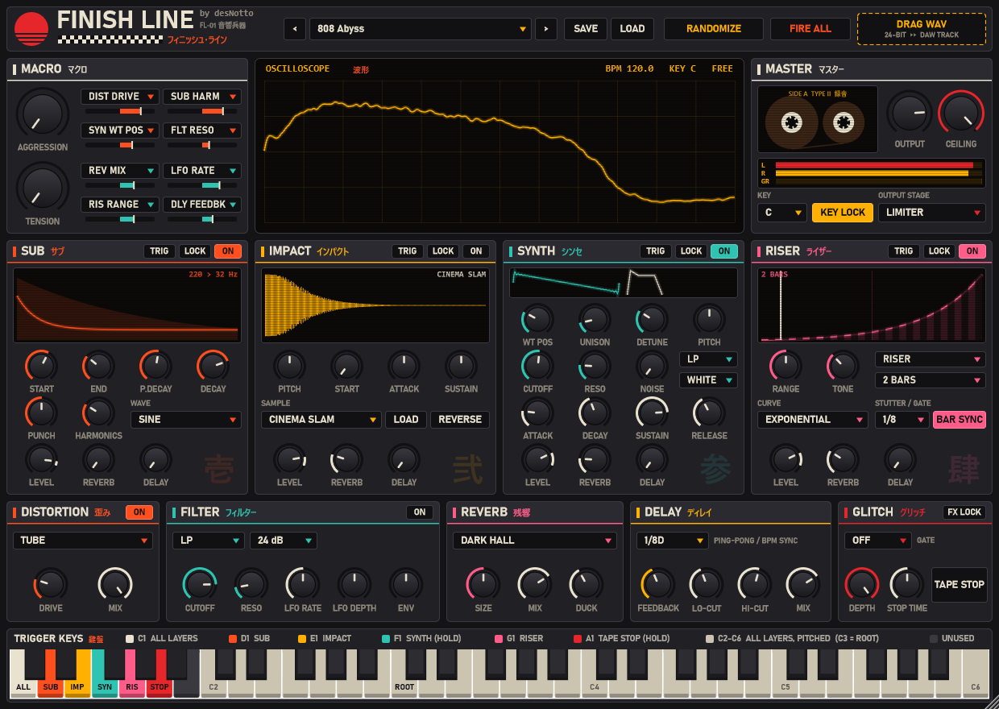

# FINISH LINE フィニッシュ・ライン

**Автор: desNotto** · VST3 · Windows x64

Гибридный синтезатор/сэмплер для пост-продакшена modern metal: саб-дропы, удары, рис-басы, дроны, райзеры, даунлифтеры, глитчи и tape-stop — в пару кликов, с привязкой к темпу и тональности проекта.



## Возможности

**4 параллельных слоя**

| Слой | Что делает | Параметры |
|---|---|---|
| **SUB** | Аналогово-моделирующий осциллятор (Sine / Triangle / Saturated Sine) с питч-огибающей | Start, End, Pitch Decay, Amp Decay, Punch, Harmonics |
| **IMPACT** | Сэмпл-плеер: 12 встроенных ударов + свой WAV/AIFF/FLAC/OGG (кнопка LOAD или drag-and-drop в окно) | Sample, Pitch, Start Offset, Reverse, Transient Shaper (Attack / Sustain) |
| **SYNTH** | Wavetable (8 морфируемых таблиц) + шум (White / Pink / Metallic), унисон до 8 голосов | WT Pos, Unison, Detune, Pitch, Noise, фильтр LP/HP/BP, ADSR |
| **RISER** | Райзер / даунлифтер / свип, длина привязана к сетке DAW | Length 1/2/4/8 тактов, Curve, Pitch Range, Tone, Stutter/Gate, Bar Sync |

У каждого слоя — уровень, посылы на реверб и дилей, ON, LOCK и кнопка прослушивания TRIG.

**Master FX**

- **Distortion** — Tube, Tape, Hard Clip, Bitcrush
- **Filter** — LP/HP/BP, 12/24 dB/oct, модуляция от LFO и огибающей
- **Reverb** — Dark Hall, Metallic Room, Infinite Canyon + ducker от сухого сигнала
- **Delay** — ping-pong с синхронизацией по BPM, Lo-Cut / Hi-Cut
- **Glitch** — Tape Stop (время торможения) и ритмический гейт 1/8, 1/16, 1/32, триоли
- **Limiter / Clipper** на выходе

**Модуляция и рандомизация**

- 2 макроса (AGGRESSION, TENSION), на каждый можно назначить до 4 параметров с глубиной ±100 %
- RANDOMIZE с блокировкой (LOCK) отдельных слоёв и FX-секции

**Workflow**

- Синхронизация с хостом: BPM, размер, позиция в такте — райзер заканчивается ровно на сильной доле
- KEY + KEY LOCK: саб и синт подстраиваются под тональность
- **DRAG WAV** — перетащите плитку из плагина на аудиотрек DAW, звук отрендерится в WAV 24-bit
- Осциллограф / спектроанализатор (клик по экрану переключает режим)
- Масштаб окна 75–200 % (тяните за правый нижний угол)
- Экранная клавиатура внизу окна: клавиши окрашены в цвета блоков, которые они запускают, и показывают входящие MIDI-ноты
- 90 заводских пресетов в 5 категориях, сохранение и загрузка своих (`Документы/desNotto/Finish Line/Presets`)

## MIDI-карта

Те же ноты доступны мышью на экранной клавиатуре плагина.

| Нота | Действие |
|---|---|
| C1 | все слои |
| D1 | SUB |
| E1 | IMPACT |
| F1 | SYNTH |
| G1 | RISER |
| A1 | Tape Stop (пока нота удерживается) |
| C2 и выше | все слои хроматически (C3 = исходная высота) |

## Сборка

Нужны Visual Studio 2022 (или Build Tools) с компонентом C++ и CMake. JUCE 8.0.4 скачивается автоматически при конфигурации.

```bat
build.bat
```

Результат: `build\FinishLine_artefacts\Release\VST3\Finish Line.vst3`. Для установки скопируйте эту папку в `C:\Program Files\Common Files\VST3`.

Офлайн-тесты (рендер всех пресетов, проверка на NaN/клиппинг, сохранение состояния, WAV-экспорт, снимок интерфейса):

```bat
cmake --build build --config Release --target FinishLineTest
build\FinishLineTest_artefacts\Release\FinishLineTest.exe build\test_out
```

## Структура

```
Source/Params.h            все параметры плагина (единая таблица)
Source/Presets.h           заводские пресеты
Source/dsp/                движок: слои, эффекты, волновые таблицы, встроенные сэмплы
Source/PluginProcessor.*   MIDI, синхронизация с хостом, состояние, рендер в WAV
Source/PluginEditor.*      интерфейс
Source/ui/Look.h           палитра и отрисовка контролов
Tests/Main.cpp             офлайн-тесты
```

## Лицензия JUCE

Плагин построен на [JUCE](https://juce.com), который распространяется по AGPLv3 либо по коммерческой лицензии. Для закрытого коммерческого релиза нужна коммерческая лицензия JUCE.
